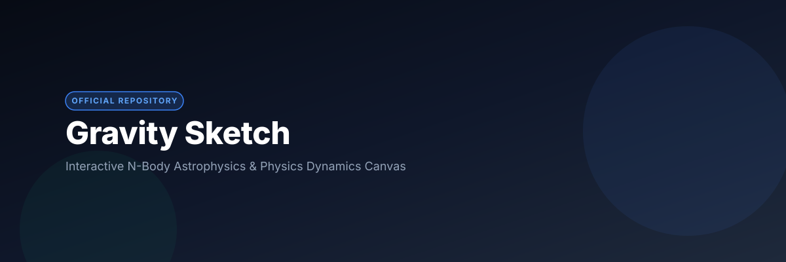
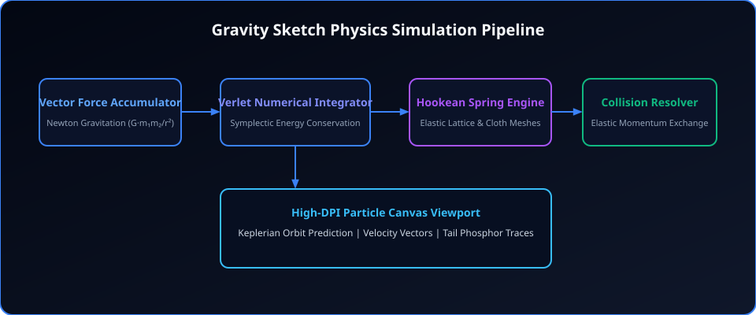
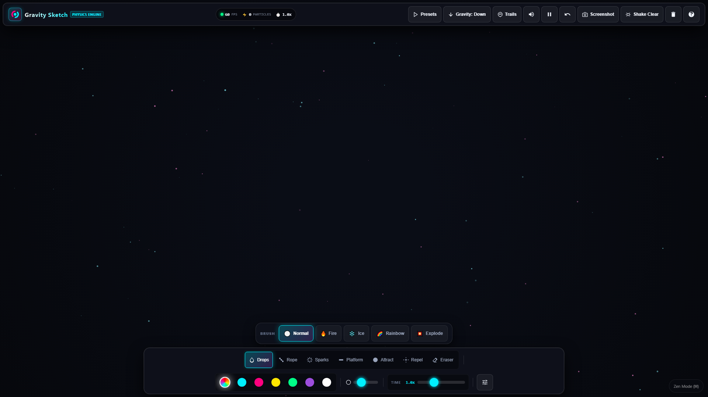

# Gravity Sketch

> Interactive N-Body Astrophysics & Physics Dynamics Canvas

   



## 📌 Executive Overview
A real-time astrophysics and classical mechanics simulation platform featuring N-body gravitational integration, Keplerian orbital tracing, elastic Hookean spring meshes, and collision physics.

---

## 🏛 System Architecture
The following diagram highlights the internal computation pipeline, data transformations, and rendering passes:



---

## 📷 Live Application Interface
Below is an authentic 1080p high-resolution capture of the live running interface:



---

## 🔬 Technical Deep-Dive
### Core Technical Specifications
- **N-Body Gravitational Computation:** Evaluates pair-wise gravitational attractions with distance softening factor $epsilon = 12.0$ to eliminate infinite force singularities at close proximities.
- **Symplectic Verlet Integration:** Utilizes Velocity Verlet numerical integration to maintain Hamiltonian energy conservation over extended simulation durations.
- **Orbital Path Forecaster:** Precomputes analytical two-body Keplerian trajectories and orbital velocities for drawn astronomical bodies.
- **Cloth and Spring Meshing:** Supports Hookean elastic spring-mass constraints for soft-body physics, ropes, and structural grids.

---

## 🚀 Quick Start Guide

### Zero-Dependency Launch
This project is built as a self-contained, high-performance HTML5 application with zero runtime dependencies.

1. **Clone the repository:**
   ```bash
   git clone https://github.com/royalodi/gravity-sketch.git
   cd gravity-sketch
   ```

2. **Launch directly in any modern browser:**
   ```bash
   # Windows (PowerShell)
   Start-Process index.html

   # macOS / Linux
   open index.html || xdg-open index.html
   ```

---

## 📄 License
This project is distributed under the **MIT License**.


---

## 👨‍💻 Author & Lead Maintainer

<table>
  <tr>
    <td align="center" width="150" valign="middle">
      <a href="https://github.com/royalodi">
        
      </a>
      <br /><br />
      <b>Royal Odi</b><br />
      <sub><i>Full-Stack Engineer</i></sub>
    </td>
    <td valign="top">
      <p>
        Designed, engineered, and maintained by <b>Royal Odi</b>. Full-Stack Engineer focused on building scalable web architectures, robust backend systems, and responsive, high-performance digital experiences.
      </p>
      <p>
        <a href="https://github.com/royalodi"></a>
        <a href="mailto:royalodi.dev@gmail.com"></a>
        <a href="https://github.com/royalodi?tab=repositories"></a>
      </p>
    </td>
  </tr>
</table>

